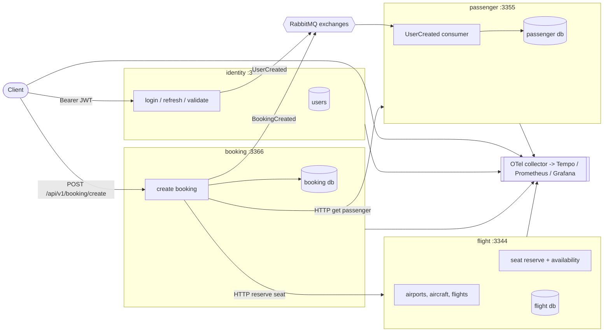

# AeroBook

AeroBook is a flight-booking backend split into four small NestJS services that talk to each
other over HTTP and RabbitMQ, with OpenTelemetry tracing and Prometheus metrics wired through the
whole thing.

## What This Project Does

Booking a seat is not one database write: you have to prove who you are, find the flight,
make sure nobody else takes the seat, and keep a passenger record. AeroBook models that as
separate services, each owning its own Postgres schema, so the flow can be studied — or
extended — one service at a time.

It is for people who want a working, all-TypeScript microservice setup rather than a
diagram: real JWT login, real seat reservation, real message contracts, real traces.

- Sign in with email and password, get an access token and a refresh token (`identity`)
- Manage airports, aircraft, flights and seats, and reserve a seat (`flight`)
- Keep passenger records, created automatically when a user signs up (`passenger`)
- Create a booking, which pulls the passenger, reserves the seat and publishes an event (`booking`)
- One shared library (`building-blocks`) for config validation, TypeORM plumbing, RabbitMQ,
  JWT guards, OpenTelemetry, error responses and pagination
- Vertical-slice layout: each feature is a folder with its command handler, DTO, entity and
  mapping, instead of a layer-wide controller/service/repository split
- Swagger UI, `/metrics` endpoint and Grafana dashboards on every service

## How It Works

Every service starts the same way: `OpenTelemetryModule.start()` boots the SDK before Nest,
then `main.ts` applies the global `api` prefix, URI versioning (`/api/v1/...`), a global
validation pipe, the JWT bearer setup, the Prometheus `/metrics` endpoint and a single
exception filter, and listens on its own port.

A booking request travels like this:

1. `POST /api/v1/identity/login` returns an access token. The token is checked on every
   protected route by `JwtGuard` + `JwtStrategy` in `building-blocks`.
2. `POST /api/v1/booking/create` hits `CreateBookingHandler`. Joi validates the body before
   anything else runs.
3. The handler calls the command bus, then uses `PassengerClient` (axios, `http://localhost:3355`,
   `GET /api/v1/passenger/get-by-id`) to load the passenger and `FlightClient` (axios,
   `http://localhost:3344`) to `POST /api/v1/seat/reserve` — the seat row is flipped to taken
   inside the flight service's own database.
4. The booking row is written through `BookingRepository` (TypeORM) into the booking database.
5. `RabbitmqPublisher.publishMessage(new BookingCreated(...))` drops the event on the
   `booking` exchange, so anything else interested can react.

The other async path is signup: when `identity` creates a user it publishes `UserCreated` on
the `identity` exchange, and `passenger` runs `CreateUserHandler.createUserConsumerHandler`
as a consumer to create the matching passenger record.

Requests and events carry a W3C trace context. `RabbitmqPublisher` injects the current span
into the message headers and `RabbitmqSubscriber` extracts it on the other side, so a trace
in Tempo spans both services rather than stopping at the queue.



## Project Structure

```
aerobook/
├── src/
│   ├── building-blocks/          # shared library, consumed as `building-blocks` via file:../building-blocks
│   │   ├── configs/              # joi schema that loads and validates .env.<NODE_ENV>
│   │   ├── context/              # HttpContext, holds the incoming request headers for outbound calls
│   │   ├── contracts/            # DTOs and events shared between services (booking, flight, identity, passenger)
│   │   ├── filters/              # single exception filter, renders RFC-7807 style problem details
│   │   ├── monitoring/           # prom-client registry, request counter + duration middleware
│   │   ├── openTelemetry/        # NodeSDK bootstrap and the tracer provider
│   │   ├── passport/             # JwtGuard and JwtStrategy
│   │   ├── rabbitmq/             # connection, publisher, subscriber, module
│   │   ├── test/container/       # testcontainers for Postgres and RabbitMQ used by the test suites
│   │   ├── types/                # application exceptions and paged-result wrapper
│   │   └── utils/                # bcrypt helpers, reflection, serialization, time, validation
│   ├── identity/                 # :3333 — users, login, access + refresh tokens
│   │   ├── src/auth/features/v1/ # login, logout, generate-token, refresh-token, validate-token
│   │   ├── src/user/features/v1/ # create, get, get-by-id, update, delete user
│   │   ├── src/data/             # data-source, migrations, repositories, seeds
│   │   └── test/                 # unit, integration and end-to-end suites
│   ├── flight/                   # :3344 — airports, aircraft, flights, seats
│   │   ├── src/{airport,aircraft,flight,seat}/  # one folder per aggregate, features/v1 inside
│   │   └── src/data/             # data-source, migrations, repositories, seed data
│   ├── passenger/                # :3355 — passenger records, consumes UserCreated
│   │   ├── src/passenger/features/v1/
│   │   └── src/user/consumers/   # create-user consumer
│   └── booking/                  # :3366 — creates bookings, calls flight + passenger
│       ├── src/booking/features/v1/create-booking/
│       ├── src/booking/http-client/services/  # flight and passenger axios clients
│       └── src/data/
├── deployments/
│   ├── docker-compose/docker-compose.yaml       # infra + the four services
│   ├── docker-compose/infrastructure.yaml       # infra only, for running services from your machine
│   └── configs/                  # prometheus, tempo, loki and otel-collector configs
├── assets/                       # airplane icon and the vertical-slice diagram
├── booking.rest                  # REST client requests against all four services
└── LICENSE                       # MIT
```

Each service folder also carries its own `Dockerfile`, `nest-cli.json`, `tsconfig.json`,
`package.json` and `.env.example` / `.env.docker.example`.

## Tech Stack

| Layer | Technology | Purpose |
| --- | --- | --- |
| Language | TypeScript 4.9.5 | everything in `src/` |
| Runtime | Node.js 18 | what the services run on |
| Framework | NestJS 9.3.9 (`@nestjs/core`, `@nestjs/common`, `@nestjs/platform-express`) | HTTP services and DI |
| Architecture | `@nestjs/cqrs` 9.0.3 | command/query handlers per feature |
| API docs | `@nestjs/swagger` 6.2.1 | Swagger UI at `/swagger` |
| Database | PostgreSQL (`pg` 8.9.0) | one schema per service |
| ORM | TypeORM 0.3.12 with `@nestjs/typeorm` 9.0.1 | entities, repositories, migrations |
| Messaging | RabbitMQ via `amqplib` 0.10.3 | `BookingCreated` / `UserCreated` events |
| Resilience | `async-retry` 1.3.3 | retrying the RabbitMQ connection |
| Auth | `@nestjs/passport` 9.0.3, `passport-jwt` 4.0.1, `@nestjs/jwt` 10.0.2, `bcryptjs` 2.4.3 | login, JWT access + refresh tokens, password hashing |
| Validation | `joi` 17.8.3, `class-validator` 0.14.0, `class-transformer` 0.5.1 | env schema, request bodies |
| Mapping | `ts-mapper` 1.2.4 | entity ↔ DTO mapping |
| Tracing/metrics | OpenTelemetry 0.35.1 / 1.9.1 (`sdk-node`, `auto-instrumentations-node`, OTLP gRPC exporters), `prom-client` 14.2.0 | traces to Tempo, metrics to Prometheus |
| Observability stack | Grafana, Tempo, Loki, OTel Collector (compose images) | dashboards, trace and log storage |
| Testing | Jest 29.5.0, `ts-jest` 29.0.5, `supertest` 6.3.3, `@faker-js/faker` 7.6.0, `typemoq` 2.1.0, `testcontainers` 9.1.3 | unit, integration and end-to-end tests against real containers |
| Formatting | Prettier 2.8.4 | `npm run format` |
| Packaging | Docker + Docker Compose | one image per service |

## How to Run This Project

### Prerequisites

- Node.js 18 and npm
- Docker and Docker Compose (for Postgres, RabbitMQ and the observability stack)
- Git

### Clone

```bash
git clone https://github.com/jawaddev921-afk/aerobook.git
cd aerobook
```

### Install dependencies

There is no root workspace — install per service, and install `building-blocks` first because
each service depends on it as `file:../building-blocks`.

```bash
cd src/building-blocks && npm install && cd ../..
cd src/identity   && npm install && cd ../..
cd src/flight     && npm install && cd ../..
cd src/passenger  && npm install && cd ../..
cd src/booking    && npm install && cd ../..
```

### Environment variables

Every service reads `.env.<NODE_ENV>` from its own folder, chosen by `NODE_ENV`
(`building-blocks/configs/configs.ts`). Copy the examples:

```bash
for s in identity flight passenger booking; do
  cp src/$s/.env.example src/$s/.env.development
done
cp src/identity/.env.test.example src/identity/.env.test
for s in identity flight passenger booking; do
  cp src/$s/.env.docker.example src/$s/.env.docker
done
```

The variables, all validated by the joi schema:

| Variable | Description | Placeholder |
| --- | --- | --- |
| `NODE_ENV` | selects the `.env.<NODE_ENV>` file and is required | `development` |
| `SERVICE_NAME` | name shown in Swagger and returned on `GET /` | `identity service` |
| `PORT` | HTTP port | `3333` |
| `JWT_SECRET` | signing key for access/refresh tokens | `change-me` |
| `JWT_ACCESS_EXPIRATION_MINUTES` | access token lifetime | `30` |
| `JWT_REFRESH_EXPIRATION_DAYS` | refresh token lifetime | `1` |
| `POSTGRES_HOST` / `POSTGRES_PORT` | database host and port | `localhost` / `5432` |
| `POSTGRES_USERNAME` / `POSTGRES_PASSWORD` | database credentials | `postgres` / `postgres` |
| `POSTGRES_Database` | database name | `identity` |
| `POSTGRES_SYNCHRONIZE` | when `true`, skips migrations and syncs entities | `false` |
| `POSTGRES_AUTO_LOAD_ENTITIES` | auto-register entities | `true` |
| `POSTGRES_ENTITIES` / `POSTGRES_MIGRATIONS` | glob paths for entities and migrations | `/../**/*.entity.{js,ts}` |
| `POSTGRES_LOGGING` | log generated SQL | `false` |
| `POSTGRES_MIGRATIONS_RUN` | run migrations on startup | `true` |
| `RABBITMQ_Host` / `RABBITMQ_PORT` | broker host and port | `localhost` / `5672` |
| `RABBITMQ_USERNAME` / `RABBITMQ_PASSWORD` | broker credentials | `guest` / `guest` |
| `RABBITMQ_EXCHANGE` | this service's exchange name | `booking` |
| `RETRY_COUNT` / `RETRY_FACTOR` | broker connection retry attempts and backoff factor | `3` / `2` |
| `RETRY_MIN_TIMEOUT` / `RETRY_MAX_TIMEOUT` | backoff bounds in ms | `1000` / `60000` |
| `OPEN_TELEMETRY_COLLECTOR_URL` | OTLP gRPC endpoint | `http://localhost:4317` |
| `OPEN_TELEMETRY_SERVICE_NAME` | service name on traces | `booking` |
| `OPEN_TELEMETRY_SERVICE_VERSION` | service version on traces | `1.0.0` |

Set a real `JWT_SECRET` before exposing any of this.

### Start the infrastructure

```bash
docker compose -f deployments/docker-compose/infrastructure.yaml up -d
```

That gives you Postgres (5432), RabbitMQ (5672, management UI 15672), Prometheus (9090),
Grafana (3000, admin/admin), Tempo, Loki and the OTel Collector (4317).

### Database setup

Migrations are TypeORM files under `src/<service>/src/data/migrations`, and each service has a
`data-source.ts`. With `POSTGRES_MIGRATIONS_RUN=true` (the default in the examples) the
migrations apply themselves when the service boots. To run them by hand, from a service
folder after `npm run build`:

```bash
npm run migration:run          # apply
npm run migration:generate     # create a new migration after changing entities
npm run migration:revert       # roll the last one back
```

`identity` and `flight` also seed data on startup: `identity` inserts a developer account
(`dev@dev.com` / `Admin@12345`, admin role) and `flight` inserts airports, aircraft, flights
and seats. Change or remove that seed before putting this anywhere public.

### Run

Each service runs in the foreground, so start them in four terminals, one per service:

```bash
cd src/identity  && npm run dev   # terminal 1
cd src/flight    && npm run dev   # terminal 2
cd src/passenger && npm run dev   # terminal 3
cd src/booking   && npm run dev   # terminal 4
```

`dev` is `nest start --watch`. You should see `🚀 Application is running on:
http://localhost:<port>` per service, and:

- `http://localhost:3333/swagger` — identity API docs (same on 3344, 3355, 3366)
- `http://localhost:3333/metrics` — Prometheus exposition (same on the other ports)
- `http://localhost:3366` — returns the service name, a quick health check

Then open `booking.rest` in VS Code with the REST Client extension and run `Login` followed by
`Create Booking` — the file chains the token through `{{Login.response.body.access.token}}`.
The same calls with curl:

```bash
curl -s -X POST http://localhost:3333/api/v1/identity/login \
  -H 'Content-Type: application/json' \
  -d '{"email":"dev@dev.com","password":"Admin@12345"}'
# {"access":{"token":"<jwt>","expires":...},"refresh":{...}}  — copy access.token

curl -s http://localhost:3344/api/v1/flight/get-by-id?id=1 \
  -H "Authorization: Bearer <access.token>"

curl -s -X POST http://localhost:3366/api/v1/booking/create \
  -H 'Content-Type: application/json' \
  -H "Authorization: Bearer <access.token>" \
  -d '{"passengerId":1,"flightId":1,"description":"I want to fly"}'
```

### Run tests

```bash
cd src/identity && npm run test
```

`npm run test` is `jest`. Only `identity` has committed test suites (unit, integration and
end-to-end under `src/identity/test`); the integration and e2e suites start Postgres and
RabbitMQ containers through `testcontainers`, so Docker must be running. Copy
`src/identity/.env.test.example` to `src/identity/.env.test` first — the test env uses
`identity_test` and `POSTGRES_SYNCHRONIZE=true`.

### Docker

To run everything, including the services, in containers (`.env.docker` files must exist):

```bash
docker compose -f deployments/docker-compose/docker-compose.yaml up --build
```

## License

MIT — see `LICENSE`.
